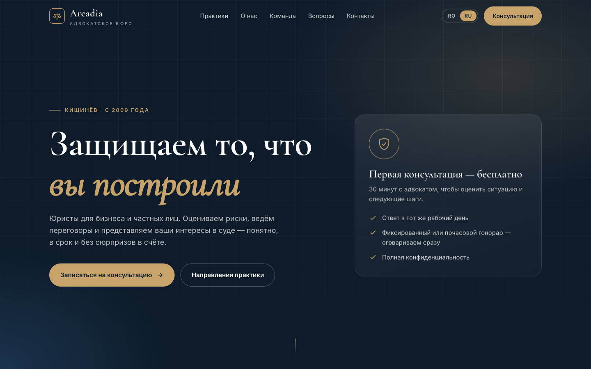
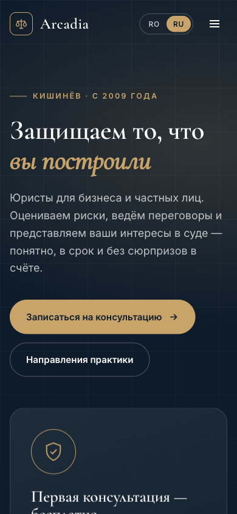

# Arcadia Legal — bilingual law firm website (RO / RU)

**Live:** https://arcadia-legal.den-danchenkoo.workers.dev

A premium landing page for a law firm in Chișinău, Moldova, built as a lead-generation site: practice areas, approach, team, FAQ and a consultation request.
**Arcadia Legal is a fictional brand** created as a design and development sample; names, numbers and contacts are placeholders.



<p align="center"></p>

## Highlights

- **Two languages without a framework** — Romanian and Russian switch instantly via `data-i18n` keys; the visitor's choice is remembered in `localStorage`.
- **Conversion-focused layout** — free-consultation offer in the hero, trust indicators, six practice areas, process, team, FAQ and a contact form.
- **Animated counters and reveals** — triggered by `IntersectionObserver` as sections scroll into view.
- **Editorial design** — Cormorant Garamond headlines with Inter body text on a dark navy and gold palette.
- **Mobile first** — tested at phone width with a collapsible navigation.
- **SEO and sharing** — description, Open Graph tags and a theme colour.
- **Zero build step** — one static HTML file deployed on Cloudflare Workers.

## Structure

```
public/index.html   Page, styles, translations and scripts
wrangler.jsonc      Cloudflare Workers static-assets deployment
docs/               Screenshots
```

## Run locally

Open `public/index.html` in a browser, or:

```bash
npx wrangler dev      # http://localhost:8787
npx wrangler deploy   # deploy to Cloudflare Workers
```

## Production notes

The contact form is front-end only in this demo. For a real client it is connected to a CRM or an n8n workflow (for example: form → n8n → HubSpot contact + Telegram alert to the team), the same pattern as in [LeadFlow AI](https://github.com/Denis88818/leadflow-ai).

## Author

Designed and built by **Denis Danchenko** — AI automation, CRM and web developer.
Available for projects on [Upwork](https://www.upwork.com/freelancers/~016707bca373f53f65).

---

The source is published as a portfolio sample.
